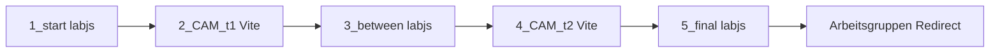
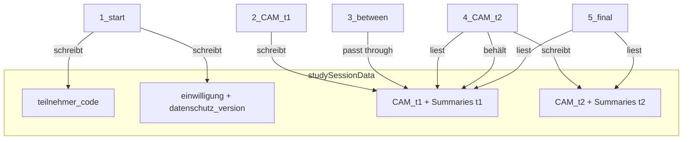

# Studienablauf — Uni Leipzig CAM (Clean Energy Valley)

Ist-Beschreibung des implementierten fünfteiligen Online-Ablaufs. Konzeptquelle: [`_briefing/`](_briefing/); Code in den fünf Komponenten-Ordnern. Offene Freigaben: [`toDos.md`](toDos.md).

---

## 1. Konzeptuelle Übersicht

Die Studie erfasst, wie Stakeholder (Politik, Verwaltung, Wirtschaft, Zivilgesellschaft) die **klimaneutrale Regionalentwicklung** am Beispiel Clean Energy Valley / Dithmarschen kognitiv und emotional repräsentieren. Teilnehmende zeichnen dafür zwei **Cognitive-Affective Maps (CAMs)** in einem Revision-Design (Delta-CAM): erst frei um einen Zentralbegriff, dann dieselbe Map mit fünf vorgegebenen Zusatzkonzepten. Am Ende gibt es aggregiertes Delta-Feedback und einen Platzhalter für das qualitative Interview.

### Tech-Split

| Teil | Ordner | Tech |
|---|---|---|
| 1 | `1_start/` | lab.js + JATOS |
| 2 | `2_CAM_t1/` | Vite-CAM + JATOS |
| 3 | `3_between/` | lab.js + JATOS |
| 4 | `4_CAM_t2/` | Vite-CAM + JATOS |
| 5 | `5_final/` | lab.js + JATOS |

Kurz: **3× lab.js**, **2× Vite-CAM**, gekoppelt über eine JATOS-Study mit gemeinsamer **Study Session**.

### Verbindliche Kette

```
1_start → 2_CAM_t1 → 3_between → 4_CAM_t2 → 5_final → Redirect Arbeitsgruppen
```



Oberfläche: Deutsch, **Sie-Form**. Keine Soft-Robot-/Prolific-/Freiburg-Inhalte aus `template/`.

---

## 2. Study Session — zentrale Architektur

### Was ist die Study Session?

`jatos.studySessionData` (gelesen) bzw. `jatos.setStudySessionData(…)` (geschrieben) ist der **temporäre Speicher eines Study-Runs**. Alle fünf Komponenten greifen darauf zu. Die Session lebt nur für den aktuellen Durchlauf in JATOS; sie ist der Handoff-Kanal zwischen lab.js und Vite-CAM.

### Session vs. Result

| Mechanismus | Zweck | Lebensdauer |
|---|---|---|
| `setStudySessionData` / `studySessionData` | Handoff zwischen Komponenten (CAM-Objekte, Code, Summaries) | nur aktueller Study-Run |
| `submitResultData` | persistentes Resultat **dieser** Komponente in JATOS | dauerhaft in den Results |

`submitResultData` **ersetzt** jeweils die Daten der aktuellen Komponente — immer ein vollständiges Objekt senden.

### Schreibmuster

Überall gilt Merge statt Replace der ganzen Session:

```javascript
const existing = jatos.studySessionData || {};
jatos.setStudySessionData(Object.assign({}, existing, sessionPayload));
```

Bestehende Keys (vor allem `CAM_t1`, `teilnehmer_code`, Einwilligung) dürfen nicht unnötig gelöscht oder überschrieben werden.

### Session-Schema (Ist-Keys)

| Key | Geschrieben von | Gelesen von |
|---|---|---|
| `teilnehmer_code` | `1_start` | alle Folge-Teile |
| `einwilligung` | `1_start` | `3_between`, CAMs, `5_final` |
| `datenschutz_version` | `1_start` | `3_between`, CAMs, `5_final` |
| `CAM_t1` | `2_CAM_t1` | `3_between` (passt through), `4_CAM_t2`, `5_final` |
| `meanValence_t1`, `nNodes_t1`, `nConnectors_t1` | `2_CAM_t1` | `4_CAM_t2` (passt through), `5_final` (optional) |
| `CAM_t2` | `4_CAM_t2` | `5_final` |
| `meanValence_t2`, `nNodes_t2`, `nConnectors_t2` | `4_CAM_t2` | `5_final` (optional) |

Hinweis: Es gibt keine Keys `cam1` / `cam2` — nur `CAM_t1` / `CAM_t2`.



---

## 3. Delta-CAM-Ansatz

Referenz: Fenn et al. (2026), *Frontiers in Robotics and AI* — XML im Repo: [`template/frobt-13-1741946.xml`](template/frobt-13-1741946.xml). Briefing: [`_briefing/03_Delta_CAM.md`](_briefing/03_Delta_CAM.md).

### Kernidee (Referenzstudie)

Eine CAM ist eine mind-map-artige Repräsentation: Konzepte mit emotionaler **Valenz**, verknüpft durch unterstützende oder hemmende Verbindungen. Statt zwei unabhängiger Maps nutzt Delta-CAM ein **Zwei-Phasen-Design**:

1. **Pre:** Teilnehmende zeichnen eine erste CAM.
2. **Intervention:** neue Information / neues Framing.
3. **Post / Revision:** dieselbe Map wird überarbeitet (Konzepte ändern, Valenzen anpassen, hinzufügen, entfernen) — nicht von Null neu gezeichnet.

Über stabile Identitäten klassifiziert die Auswertung jedes Konzept (und analog Verbindungen) als:

| Klasse | Bedeutung |
|---|---|
| **constant** | in CAM1 und CAM2 aktiv (gleiche `id`) |
| **deleted** | in CAM1 aktiv, in CAM2 nicht mehr aktiv |
| **new** | erst in CAM2 hinzugekommen |

Damit misst man **revision-basierte Verschiebungen** (Valenz, Argumentstruktur, Anzahl Konzepte), nicht den Vergleich zweier isolierter Maps.

### Leipzig-Anpassung

Die „Intervention“ ist hier nicht Soft- vs. Rigid-Robot, sondern:

1. **CAM1** (`2_CAM_t1`): freie Map um den Zentralbegriff `klimaneutrale Regionalentwicklung`
2. **CAM2** (`4_CAM_t2`): dieselbe Map (identische UUIDs) + fünf Fix-Konzepte: `Windenergie`, `Wasserstoff`, `Netzausbau`, `Akzeptanz`, `Arbeitsplätze`

Live-Feedback in `5_final` (`src/js/lib/deltaCam.js`, Funktion `computeCamDelta`): Valenz-Trend (`positiver` / `negativer` / `etwa_gleich`), Δ aktive Nodes/Connectors, Zähler constant/deleted/new.

### Technische Voraussetzung: UUID-Erhalt

- Identität = Node-/Connector-Feld `id` (UUID) in `store.cam`
- Beim Laden in Teil 4: IDs über `importElement` / `setNodeImport` **wiederherstellen**, nicht neu erzeugen
- Legacy-`template/CAMEL_second` verwirft IDs absichtlich — für Leipzig **falsch**
- Importierte CAM1-Elemente behalten ihre IDs; die fünf Fix-Konzepte und neu gezeichnete Konzepte erhalten **neue** UUIDs
- Live-Feedback ist aktuell **aggregiert**; der volle per-Element-Diff (Valenz/Text/Kommentar je `constant`) laut Briefing ist noch nicht implementiert

---

## 4. Teil-für-Teil

### Teil 1 — `1_start/` (lab.js)

**Konzept:** Einstieg, CAM-Erklärung, informierte Einwilligung, Pseudonym-Code, Überleitung zur ersten CAM.

**Screens** (`study.js`):

1. `AdminId_htmlForm` — Administration: Anzeige des Zufalls-Codes
2. `Welcome_htmlForm` — Begrüßung Clean Energy Valley
3. `Ablauf_htmlForm` — fünf Teile skizzieren
4. `Cams_htmlForm` — kurze CAM-Erklärung
5. `Consent_htmlForm` — Pflichtauswahl einverstanden / nicht
6. `ConsentNo_htmlScreen` — nur ohne Einwilligung; `jatos.endStudy(false, …)`
7. `Ueberleitung_htmlForm` — nur mit Einwilligung; Übergang zu CAM1

**Daten:**

- `teilnehmer_code`: 8 Zeichen `a–z` + `0–9` (`generateTeilnehmerCode` in `globals.js`), einmalig beim Laden
- `session_id`: Browser-UUID im lab.js-Datastore (nicht in der Study Session)
- Consent: Formfeld `consent` `"1"`/`"0"` → `einwilligung` Boolean + `datenschutz_version` (aktuell `entwurf-2026-03-01`)
- **Vor Einwilligung nichts senden.** Bei Ja: `saveToJatos()` = `datastore.exportJson()` → `submitResultData`

**Session beim Weiter:** `teilnehmer_code`, `einwilligung: true`, `datenschutz_version` → `setStudySessionData` → `startNextComponent()`.

---

### Teil 2 — `2_CAM_t1/` (Vite-CAM)

**Konzept:** Erste freie CAM um den Zentralbegriff.

**Startzustand** (`config/defaultCAM.js`):

- Nur Node `klimaneutrale Regionalentwicklung` (Mitte)
- Flags: `isDraggable=false`, `isDeletable=false`, `isTextChangeable=false`
- Projektname: `CleanEnergyValley_CAM_t1`
- Zustand in `store.cam` (kein globales `CAM`)

**Speichern** (`saveButton.js`):

1. Validierung (u. a. Connectivity der aktiven Nodes)
2. `teilnehmer_code` aus Session (Fallback `"noID"`, kein neuer Code)
3. `store.cam.creator = teilnehmer_code`
4. Deep-Serialize: `JSON.parse(JSON.stringify(store.cam))`
5. Session-Payload: `CAM_t1`, Summaries (`meanValence_t1`, `nNodes_t1`, `nConnectors_t1`), `teilnehmer_code`; Merge mit bestehender Session (Einwilligung bleibt)
6. `submitResultData(camSerialized)` — Resultat = CAM-Objekt
7. `startNextComponent()` → Teil 3

---

### Teil 3 — `3_between/` (lab.js)

**Konzept:** Kurze Pause / Überleitung zwischen den beiden CAM-Phasen; Session inkl. `CAM_t1` durchreichen.

**Screens (Ist):**

1. `DankeCam1_htmlForm` — Dank nach CAM1
2. `UeberleitungCam2_htmlForm` — Hinweis auf vorgegebene Konzepte in CAM2

Kein Fragebogen im Code (Briefing sieht Platzhalter „Fragebogen folgt“ vor; aktuell nur Dank + Überleitung).

**Daten:**

- Liest Session; kopiert `teilnehmer_code`, `einwilligung`, `datenschutz_version` in den lab.js-Datastore
- `CAM_t1` und Summaries bleiben in der Session unangetastet
- Result: `datastore.exportJson()` → `submitResultData`
- Exit: Merge nur mit aufgefrischtem `teilnehmer_code` → `startNextComponent()` → Teil 4

---

### Teil 4 — `4_CAM_t2/` (Vite-CAM)

**Konzept:** Revision der CAM1 plus fünf Fix-Konzepte (Delta-CAM-Post-Phase).

**Laden** (`config/defaultCAM.js`):

1. `session.CAM_t1` lesen
2. Aktive Nodes, dann Connectors importieren (`store.cam.importElement`) — IDs über `setNodeImport` / Connector-`id`-Overwrite erhalten
3. Fünf Fix-Konzepte oben links hinzufügen (jeweils neue UUID):

| Text | Flags |
|---|---|
| Windenergie, Wasserstoff, Netzausbau, Akzeptanz, Arbeitsplätze | `isDraggable=true`, `isDeletable=true`, `isTextChangeable=false` |

- Projektname: `CleanEnergyValley_CAM_t2`
- Lokal: `jatosStub` liefert Mock-`CAM_t1` inkl. deterministischer Zentralbegriff-UUID

**Speichern:** analog Teil 2, schreibt `CAM_t2` + Summaries t2, **behält** `CAM_t1` und t1-Summaries → `startNextComponent()` → Teil 5.

---

### Teil 5 — `5_final/` (lab.js)

**Konzept:** Adaptives Delta-Feedback, Interview-Platzhalter, Studienende, Redirect.

**Screens:**

1. `DeltaFeedback_htmlForm` — Live-Vergleich CAM1 vs. CAM2
2. `Interview_htmlForm` — Platzhalter qualitatives Interview
3. `Thanks_htmlForm` — Verabschiedung → finaler Submit + Redirect

**Delta** (`src/js/lib/deltaCam.js`):

- Liest `CAM_t1` / `CAM_t2` aus Session (lokal: `LOCAL_MOCK_SESSION`)
- Nur `isActive === true`; Match über `id`
- Speichert u. a. `delta_ok`, `delta_valence_trend`, Mittelwerte, Δ Nodes/Connectors, `delta_n_new` / `_deleted` / `_constant`

**Ende:** `finishFinalAndRedirect()` → `submitResultData(datastore.exportJson())` → `jatos.endStudyAndRedirect(END_REDIRECT_URL)`.  
`END_REDIRECT_URL` ist derzeit `"#"` — `TODO(Leipzig)`.

---

## 5. Result-Muster und lokales Testen

| Komponente | `submitResultData`-Inhalt |
|---|---|
| `1_start` | lab.js `datastore.exportJson()` |
| `2_CAM_t1` | serialisiertes CAM-Objekt |
| `3_between` | lab.js `datastore.exportJson()` |
| `4_CAM_t2` | serialisiertes CAM-Objekt |
| `5_final` | lab.js `datastore.exportJson()` (inkl. Delta-Felder) |

Übergänge Teil 1–4: `startNextComponent()` (kein `endStudy`, Ausnahme: Abbruch ohne Einwilligung in Teil 1).

**Lokal:**

- lab.js: Live Server auf der jeweiligen `index.html`; `jatos.js`-404 ist harmlos
- CAM: `npm install` → `npm run dev` im Teil-Ordner; JATOS-Build: `npm run build:jatos`
- CAM-Stubs: `2_CAM_t1` startet mit leerer Session; `4_CAM_t2` mit Mock-`CAM_t1` für UUID-Checks
- Dev-Konsole nur unter `npm run dev`: `const { store } = await import("/src/js/app/store.js"); store.cam.nodes`

---

## 6. Offene Punkte (flow-relevant)

Details und Checkboxen: [`toDos.md`](toDos.md).

- Finaler Einwilligungstext / `datenschutz_version` / Ethik-DSB
- `END_REDIRECT_URL` (Arbeitsgruppen)
- Interview-Leitfaden (Inhalt Teil 5)
- Zwischenfragen in Teil 3 noch minimal (kein Fragebogen)
- Gesamtdauer / Zeitangaben je Teil
- Submit-Fehler blockieren Transition/Redirect in lab.js-Teilen derzeit nicht
- Voller per-Element-Delta-Diff noch nicht im Frontend
